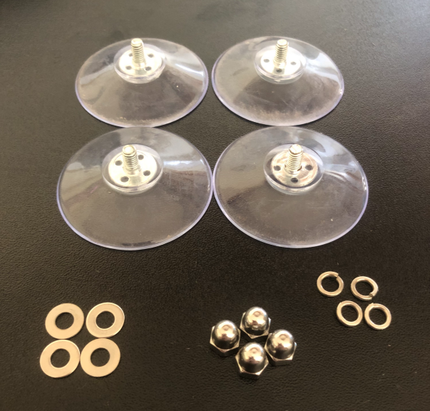
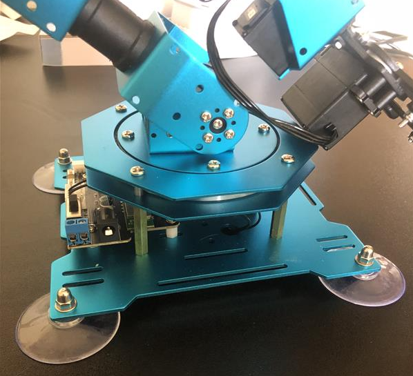
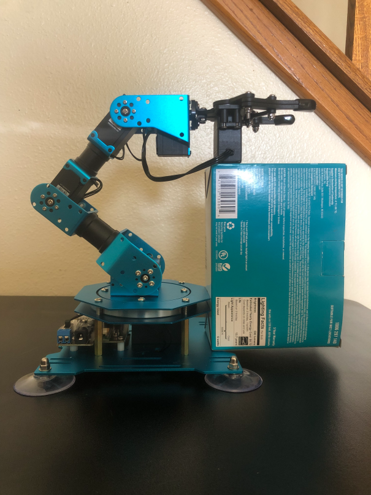
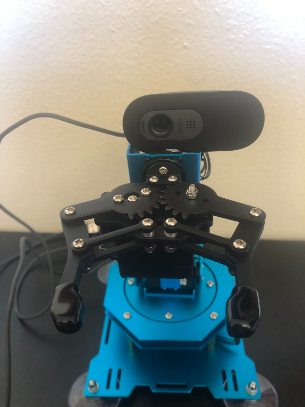
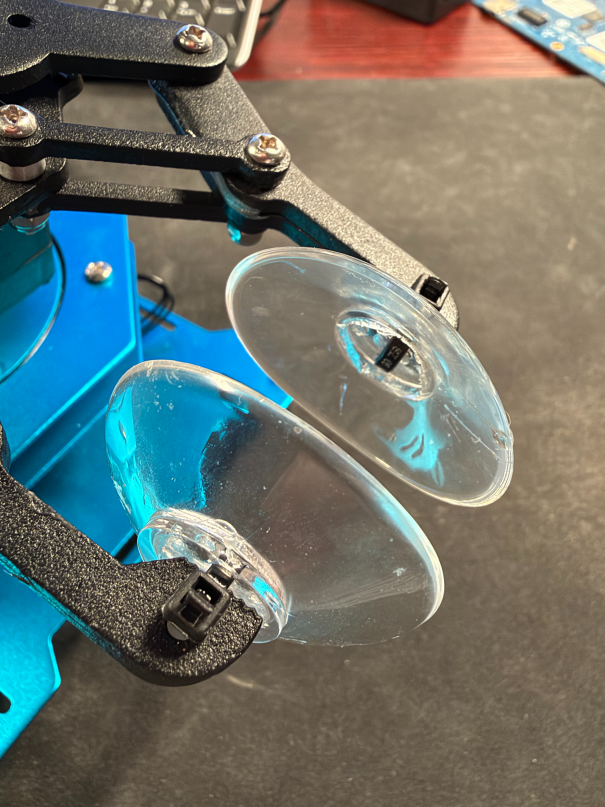
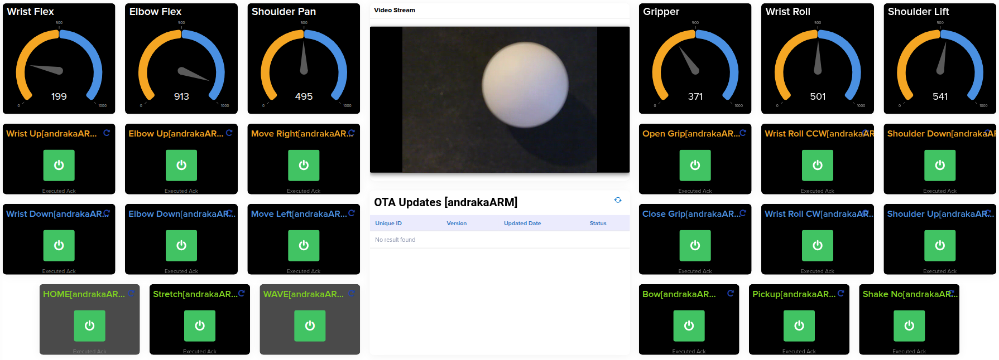

# Arduino VENTUNO Q + /IOTCONNECT — XArm Vision Demos

> [!NOTE]
> This is the **Arduino VENTUNO Q** port of the
> [Tria VisionAI Kit 6490 robotic-arm demo](https://github.com/avnet-iotconnect/iotc-tria-vision-ai-kit-robotic-arm).
> The demos, arm, camera and cloud setup are the same; only the board and its
> software setup differ (Ubuntu
> 24.04, the `arduino` user instead of root, Qualcomm's apt packages for the
> NPU runtime, and the GNOME desktop instead of Weston). Board-specific paths
> live in [scripts/board-env.sh](scripts/board-env.sh).

Three independent vision-driven robotic-arm demos that all run on the same
**Arduino VENTUNO Q** (Qualcomm Dragonwing IQ-8275 SoC, 40 TOPS Hexagon NPU)
board and stream telemetry + accept remote commands through **/IOTCONNECT**. Each demo highlights a
different rung of perception sophistication on the same hardware:

```
   1. ASL gesture control          MediaPipe + PointNet          CPU
   2. HSV pick-and-place           Classical CV (OpenCV)         CPU
   3. YOLO + depth pick-and-place  Custom YOLOv8n + MiDaS-V2    Hexagon NPU
```

The progression is the demo: same arm, same camera, same cloud platform —
showing classical CV vs. NPU-accelerated deep learning side by side.

> [!TIP]
> If you are new to /IOTCONNECT, the [/IOTCONNECT Python Lite SDK
> demos](https://github.com/avnet-iotconnect/iotc-python-lite-sdk-demos)
> are a good way to get familiar with the /IOTCONNECT UI before proceeding on to this project.

---

## Hardware Requirements

### Board
- **[Arduino VENTUNO Q](https://store.arduino.cc/products/ventuno-q)**
- Power: a 5V/3A USB-C supply, or 12–24 VDC on the barrel jack
- USB-C cable to a PC (optional — for `adb shell` access during setup)

### Purchased Separately
- **[Hiwonder xArm
  1S](https://www.amazon.com/LewanSoul-Programmable-Feedback-Parameter-Programming/dp/B0CHY63V9P?th=1)** — 6-DOF arm +
  gripper, USB
- Ethernet Cable
- **USB camera** — mounted on the wrist roll servo for demos #2/#3 (eye-in-hand);
  any operator-facing USB camera for demo #1. The reference build uses a
  Logitech Brio 100; any UVC camera works.

> [!TIP]
> If possible, it is recommended to use a bare USB-camera PCB module mounted directly
> behind the gripper jaws, giving the cleanest line of sight to whatever the gripper
> is about to grab and removing the parallax that makes the camera-gripper offset
> calibration necessary.

- USB Mouse and Keyboard
- HDMI Monitor and HDMI cable (the VENTUNO Q has a full-size HDMI port)
- One practice ball (Nerf Rival Ammo balls work well — small, matte, compress
  slightly inside the gripper)
- A target drop box (any small container in a distinct color, e.g. blue) — for
  demo #2 pickplace and demo #3

---

## Hardware Assembly

### Hiwonder XArm 1S Robotic Arm Setup

> [!NOTE]
> It is assumed that users have purchased the pre-assembled version of the robotic
> arm. If not, follow Hiwonder's assembly instructions first and then return here.

1. Attach the included suction-cup feet to the base of the arm using the provided
   hardware as shown below:





2. Using a strong adhesive (epoxy works well), attach your USB camera to the top of
   the wrist ("hand") rotational servo motor.

> [!TIP]
> Prop up the arm with a small box (see image below) and use masking tape to hold
> the camera in position while the adhesive sets. A "helping hand" soldering arm
> can also hold the USB cable of the camera for added stability.



> [!IMPORTANT]
> Ensure no adhesive drips down into any joints or moving parts.

3. After the adhesive has cured, the final camera mounting should look like this:



### Arduino VENTUNO Q Hardware Setup

- Connect ethernet cable to the board's 2.5GbE port (or use Wi-Fi)
- Connect the HDMI monitor
- Connect the xArm USB cable and the USB camera to the two USB-A ports. With a
  mouse + keyboard as well, use a powered USB hub.
- Connect power (USB-C 5V/3A, or 12–24 VDC barrel jack)

### Optional: Suction-Cup Gripper Tips

For the ball pick-up demos (Demo 2 and Demo 3), larger "hands" on the gripper
jaws make the grab much more forgiving: the ball no longer has to sit exactly
between the narrow jaw tips. This step is optional, but it raises the pick-up
success rate significantly.

1. Pull the rubber caps off the ends of both gripper jaws.
2. Punch a small hole in the center of two suction cups.
3. Attach one suction cup to each bare jaw tip with a small zip tie through the
   hole, as shown below.



> [!IMPORTANT]
> The suction cups change where the jaws close relative to the camera. After
> attaching them, re-run the camera-gripper calibration
> ([2d. Camera-Gripper Calibration](#2d-camera-gripper-calibration--calibrate_offset)),
> both the view pose and the grab pose, before running the ball demos.

> [!TIP]
> If the cups stick together after the gripper closes on nothing, the demo
> automatically snaps the jaws open a few times to pull them apart. If they are
> still stuck, pull them apart by hand.

---

## Repository Layout

| Path | What's in it |
| --- | --- |
| `main.py`, `start.sh` | The demo app and its launcher (also what `robotarm.service` runs) |
| `bootstrap-new-board.sh` | One-time board setup |
| `modes/` | Demo modes: ASL, HSV ball-follow / pick-place, YOLO pick-place |
| `detectors/` | YOLO and MiDaS depth detectors (Hexagon NPU) |
| `core/` | Shared modules: camera settings, saved calibration, kinematics, web view, WebRTC |
| `calibration/` | Calibration scripts (ball/box color, scan poses, camera-gripper offset) |
| `scripts/` | Board launchers (`calibrate.sh`, `teach.sh`, `launch-gui.sh`, ...) and `board-env.sh` |
| `deploy/` | Autostart service and watchdog |
| `iotconnect/` | /IOTCONNECT device template and dashboard export |
| `tools/` | Diagnostics, dataset capture/labeling, model training, standalone YOLO app |
| `docs/` | Developer docs: [how each demo works](docs/demos-in-depth.md), [custom NPU model training](docs/custom-npu-detector.md) |
| `model/`, `positions/`, `media/` | Model download helpers, sample poses, README images |

Calibration files (`ball_color.json`, `scan_poses.json`, `camera_settings.json`, ...)
are written to the repo root on the board and are not committed.

---

## First-Time Setup

> [!NOTE]
> These steps only need to be performed once. After completing them, see
> [Starting the Demo](#starting-the-demo) for the commands to run after
> every reboot.

### 1. Board Bring-Up

1. **Power on** and complete Arduino's first-boot screens on the HDMI monitor
   (accept the terms, set up the `arduino` user). Until this is done the
   desktop does not start.
2. **Get a shell on the board**, either:
   - from a PC over the USB-C cable: `adb shell` (`adb` ships with
     [Arduino App Lab](https://www.arduino.cc/en/software)), or
   - over the network, after enabling SSH once from the board's terminal:
     ```bash
     sudo systemctl enable --now ssh
     ssh arduino@<board-ip>
     ```

### 2. Clone + Bootstrap

Clone this repo into the `arduino` user's home and run the bootstrap
script **as `arduino` (not root)** — it asks for the `arduino` password once
for the system steps:

```bash
cd ~
git clone https://github.com/avnet-iotconnect/iotc-arduino-ventuno-q-robotic-arm.git
cd iotc-arduino-ventuno-q-robotic-arm
./bootstrap-new-board.sh
```

[bootstrap-new-board.sh](bootstrap-new-board.sh) is idempotent (safe to
re-run) and does everything the Tria image provides out of the box:

| Step | What |
|---|---|
| NPU runtime | `apt install qairt-libs qairt-dsp-binaries` from the board's Qualcomm PPA — `/usr/lib/libQnnTFLiteDelegate.so` + the Hexagon v75 libs in `/usr/lib/dsp/cdsp` |
| xArm access | udev rule so the `arduino` user can open the arm over USB HID |
| Models | YOLO-X and MiDaS-V2 w8a8 from Qualcomm AI Hub into `/etc/models` (labels into `/etc/labels`) |
| Python | Miniforge in `~/miniforge3`, conda env `iotc-ventuno-xarm` (Python 3.11 + OpenCV), `requirements.txt` + `requirements-yolo.txt` |
| Demo files | PointNet weights (demo #1), default `camera_settings.json` |
| Desktop | "XArm: …" launchers in the GNOME app grid (calibrate ball/box, ball demo, pick-place demo, terminal) |
| Autostart | `robotarm.service` (runs [deploy/arm_watchdog.sh](deploy/arm_watchdog.sh) as `arduino`) — boots the app in IDLE |

Check the NPU afterwards (needs the USB camera plugged in):
```bash
source scripts/board-env.sh && python tools/diagnostics/yolo_selftest.py   # expect: NPU=YES (Hexagon HTP via QNN)
```

### 3. ASL Model Weights (Demo #1 Only)

The PointNet classifier weights are not bundled in the repo. Download them once:

```bash
sh model/get-model.sh
ls -lh model/point_net_1.pth   # should be ~38–42 MB
```

Demo #1 will refuse to start with a clear error if this file is absent.

### 4. /IOTCONNECT Onboarding

The board needs three files from /IOTCONNECT in the project directory
(`~/iotc-arduino-ventuno-q-robotic-arm`), with **exactly these names**:

| File | What it is |
|---|---|
| `iotcDeviceConfig.json` | Device configuration (which account/device to connect as) |
| `device-cert.pem` | Device certificate |
| `device-pkey.pem` | Device private key — keep it secret |

They are git-ignored, so they never get committed.

#### 4a. Create the device template (once per account)

1. Log in to [console.iotconnect.io](https://console.iotconnect.io) and go to
   **Device → Templates → Create Template → Import**.
2. Select [`robarmwebrtc-template.json`](iotconnect/robarmwebrtc-template.json) from this
   repo. It appears in /IOTCONNECT as **`robarmRTC`**.

> [!NOTE]
> If you imported `robarmRTC` from an older copy of this repo, import it again —
> newer versions add commands (e.g. `camera_preset`, the YOLO grab controls
> `set_grab_*`) and telemetry fields. The old `set_mode_<name>` and
> `calibrate_<name>` commands were replaced by `set_mode mode=<name>` and
> `calibrate target=<name>`; the app still accepts the old ones from an old template.

#### 4b. Create the device

1. Go to **Device → Devices → Create Device**. Set **Unique ID** and **Device
   Name** to the same value (e.g. `VentunoQArm`), pick your **Entity**, and
   select the **`robarmRTC`** template.
2. **Stream Resource:** choose **WebRTC** if you want live video (`--webrtc`).

> [!IMPORTANT]
> The Stream Resource cannot be changed after the device is created. A device
> created without WebRTC (or with a different template) can still run every demo,
> just not with `--webrtc` — to add video later you must create a new device.

3. **Device Certificate:** choose **Auto-generated** and save the device.

#### 4c. Download the credentials and copy them to the board

1. On the device's page, download:
   - the **certificates** zip (e.g. `VentunoQArm-certificates.zip`), which
     contains `cert_<device>.crt` and `pk_<device>.pem`, and
   - the **device configuration** file (paper-and-cog icon), which downloads as
     `iotcDeviceConfig.json` (your browser may add a number, e.g.
     `iotcDeviceConfig (3).json`).
2. Unzip the certificates, then copy the three files to the board **and rename
   them** as shown. Both certificate files are already PEM — renaming the
   `.crt` to `.pem` is all that's needed, no conversion. From your PC, in the
   folder where you downloaded them:

   Over the network:
   ```bash
   scp cert_<device>.crt     arduino@<board-ip>:~/iotc-arduino-ventuno-q-robotic-arm/device-cert.pem
   scp pk_<device>.pem       arduino@<board-ip>:~/iotc-arduino-ventuno-q-robotic-arm/device-pkey.pem
   scp iotcDeviceConfig.json arduino@<board-ip>:~/iotc-arduino-ventuno-q-robotic-arm/iotcDeviceConfig.json
   ```
   Or over the USB-C cable (`adb` ships with Arduino App Lab):
   ```bash
   adb push cert_<device>.crt     /home/arduino/iotc-arduino-ventuno-q-robotic-arm/device-cert.pem
   adb push pk_<device>.pem       /home/arduino/iotc-arduino-ventuno-q-robotic-arm/device-pkey.pem
   adb push iotcDeviceConfig.json /home/arduino/iotc-arduino-ventuno-q-robotic-arm/iotcDeviceConfig.json
   ```
   Put quotes around a file name that contains spaces, e.g.
   `"iotcDeviceConfig (3).json"`.

#### 4d. Check the files

On the board:
```bash
cd ~/iotc-arduino-ventuno-q-robotic-arm
ls -l iotcDeviceConfig.json device-cert.pem device-pkey.pem   # all three present
chmod 600 device-pkey.pem                                     # key readable only by you
grep -o '"uid": *"[^"]*"' iotcDeviceConfig.json               # should show your device's Unique ID
```

All three demos then publish telemetry and accept remote commands automatically.
If the app prints `IoTConnect device config file not found`, a file is missing or
misnamed; if it fails to connect, check that the certificate, key and config all
came from the same device.

---

## Starting the Demo

After the board has been set up and rebooted, run these commands each time to
start the demo:

The bootstrap installs `robotarm.service`, which starts the app in IDLE on
every boot (arm still, cloud connected) — start/stop movement from the
dashboard with `set_mode`. To run it by hand instead:

1. **Get a shell on the board** (`ssh arduino@<board-ip>` or `adb shell`) and
   pause the autostart supervisor so it doesn't fight you for the arm:
   ```bash
   touch /tmp/demo_watchdog_off && pkill -f 'python -u main.py'
   ```

2. **Launch** ([start.sh](start.sh) activates the conda env and NPU paths
   from [scripts/board-env.sh](scripts/board-env.sh)):
   ```bash
   cd ~/iotc-arduino-ventuno-q-robotic-arm
   ./start.sh --webrtc
   ```

> [!NOTE]
> From SSH/adb the preview window only reaches the HDMI monitor through
> the desktop session — use `./scripts/launch-gui.sh ball` (etc.), or the
> "XArm: …" launchers on the desktop. Resume autostart with
> `rm /tmp/demo_watchdog_off`.

> [!NOTE]
> If running over SSH with no monitor connected, add `--headless` to suppress
> the camera preview window:
> ```bash
> ./start.sh --webrtc --headless
> ```

> [!NOTE]
> `--webrtc` enables live video streaming to the /IOTCONNECT portal. To run a
> specific demo mode, add `--mode <name>` (e.g. `--mode asl`, `--mode ball`,
> `--mode yolo-pickplace`). Default is `asl`.

---

## Demo 1 — ASL Gesture Control (`--mode asl`)

Sign single-handed ASL letters in front of the camera and the arm responds in
real time. MediaPipe finds the hand and a PointNet model classifies the letter,
all on the board, with no per-site calibration.

> [!TIP]
> How it works, how to change the gesture mapping, and troubleshooting:
> [Demos In Depth — Demo 1](docs/demos-in-depth.md#demo-1--asl-gesture-control).

### Camera Setup

Use an operator-facing USB camera (not the wrist camera used by Demos 2 and 3),
or re-mount the wrist camera to face you.

- 1.5–3 feet from the signing hand, at shoulder-to-chest height.
- The hand should fill roughly ¼–⅓ of the frame.
- Light the hand from the front; avoid a bright window or lamp behind it.
- The camera is auto-detected. For a different camera, find its index with
  `v4l2-ctl --list-devices` and add `--camera N`.

### Running the Demo

From the /IOTCONNECT dashboard send `set_mode mode=asl`, or on the board:

```bash
./start.sh --mode asl                                        # local monitor
python3 main.py --mode asl --headless --web-port 8080        # over SSH
```

With `--web-port`, watch the live view at `http://<board-ip>:8080/`.

### Controls

| Hand | Sign | Arm Action |
|------|------|------------|
| Left | A | Advance (move forward) |
| Left | B | Back up (move backward) |
| Left | L | Left (shoulder pan) |
| Left | R | Right (shoulder pan) |
| Left | U | Up (raise) |
| Left | Y | Down (lower) |
| Left | H | Home (all servos to center) |
| Right | A | Close gripper |
| Right | B | Open gripper |

- The overlay shows the recognized letter for each hand (`LEFT=` / `RIGHT=`)
  and, under it, the action it triggers.
- A command fires when the recognized sign **changes**; holding a sign does not
  repeat it. To repeat an action, show any other letter, then sign it again.
- Sign with one hand at a time.

> [!NOTE]
> The physical direction of Advance/Backup/Left/Right depends on how the arm is
> mounted. If the arm moves the wrong way, swap the actions in
> `LEFT_GESTURE_TO_ACTION` in `modes/asl.py`.

---

## Demo 2 — HSV Pick-and-Place (`--mode ball` / `--mode pickplace`)

Fully autonomous pick-up using classical computer vision only: the ball is
found by its color, and the arm steers itself until the ball sits where the
gripper can grab it. No machine learning, no NPU.

- `--mode ball` — find the ball, grab it, return home
- `--mode pickplace` — also find a drop box and drop the ball into it, then repeat

> [!NOTE]
> Pick-up success depends on camera angle, lighting, calibration, ball
> position, and surface/room colors. If your setup can't reliably pick up the
> ball, see the troubleshooting in
> [Demos In Depth — Demo 2](docs/demos-in-depth.md#demo-2--hsv-pick-and-place),
> which also explains how the demo works and how to tune it.

### One-Time Calibration (Per Site / Per Ball / Per Lighting)

Do these in order.

> [!WARNING]
> All calibration scripts release all six servo torques so you
> can free-pose the arm to aim the wrist camera. **Always support the arm before
> pressing Enter**, especially on a wall- or ceiling-mounted arm.

#### 2a. Ball Color — `calibration/ball_calibrate.py`

> [!IMPORTANT]
> This script opens a preview window, so it needs an HDMI monitor, mouse, and
> keyboard on the board. Over SSH, use the browser version instead: send
> `calibrate target=ball` from the dashboard and open `http://<board-ip>:8000/`.

```bash
./scripts/calibrate.sh
```

1. Hold the arm, press Enter → torque drops. Aim the camera at the ball.
2. Click the ball 5–10 times in different spots, including slightly shadowed
   areas. The green overlay shows what the demo will detect.
3. `s` = save (writes `ball_color.json`), `r` = reset, `h` = torque on,
   `w` = torque off, `q`/ESC = quit without saving.

#### 2b. Scan Poses — `calibration/teach_pose.py`

The poses the arm cycles through while searching for the ball.

```bash
./scripts/teach.sh
```

1. Hold the arm, press Enter → torque drops.
2. Pose the arm at each of the six positions as prompted — a **near** row and a
   **far** row, each at left, center and right — and press `s` + Enter for each.
   `h` + Enter = torque on, `r` + Enter = torque off.

> [!IMPORTANT]
> The scan poses are **search positions only**, not grab positions. For each
> pose, point the wrist camera **down at the table** with a clear view of that
> area, and keep the gripper well above the table.

Or teach them from the dashboard: `release_torque` → pose the arm →
`hold_pose` → `teach_scan_pose name=center` (repeat for `left` and `right`).
Poses taught this way take priority over the script's.

#### 2c. Drop Box Color (Pickplace Only)

```bash
python3 calibration/ball_calibrate.py --output box_color.json
```

Same steps as 2a, clicking the drop box (or send `calibrate target=box`).
Optional: to choose exactly where the ball is released, hold the arm above the
box and send `release_torque` → position the gripper → `hold_pose` →
`teach_drop_pose`.

#### 2d. Camera-Gripper Calibration — `calibrate_offset`

Teaches the arm where the gripper is relative to **your** camera mount. Needs
`ball_color.json` from 2a. Send `calibrate target=offset` from the dashboard (or run
`./scripts/calibrate-offset.sh` with the demo stopped), then open
`http://<board-ip>:8000/`:

1. **Support the arm** — torque drops when the calibrator starts.
2. Place the ball on the table. Pose the arm at the **view pose**: gripper just
   above/behind the ball, ball fully in view (green circle). Keep holding the
   arm and click **1. Snapshot view pose**.
3. **Without moving the ball**, move the arm so the open jaws are around it at
   the height they should close, and click **2. Snapshot grab pose**. Skip this
   if the camera can still see the ball between the jaws.
4. Click **Hold pose**, then **Quit**.

Redoing step 1 clears step 2, so always redo both. This calibration also teaches
the grab depth for Demo 3.

### Running the Demo

From the dashboard send `set_mode mode=ball` or `set_mode mode=pickplace`, or on
the board:

```bash
./start.sh --mode ball                                       # or --mode pickplace
python3 main.py --mode pickplace --headless --web-port 8080  # over SSH
```

The arm cycles through the scan poses until it sees the ball, centers on it,
reaches down, and grabs.

- **`ball`:** the arm returns home holding the ball. Send `open_gripper` to
  release it and start the next pick-up.
- **`pickplace`:** the arm carries the ball to the box, drops it, and starts
  looking for the next ball. Balls already in the box are ignored.

Send `set_mode mode=idle` to stop.

---

## Demo 3 — YOLO + Depth Pick-and-Place (`--mode yolo-pickplace`)

Demo 2 with two neural networks running on the Hexagon NPU:

- **YOLO** object detection finds the ball instead of the color filter — robust
  to lighting changes, partial occlusion, and similar-colored backgrounds.
- **MiDaS** depth estimation helps decide when the ball is close enough to
  grab.

Both run on the NPU, leaving the CPU free for the control loop. The live view
and telemetry show each model's inference time.

It works out of the box with the board's stock YOLO-X model (COCO "sports
ball"). To train a model on your own ball, see
[`docs/custom-npu-detector.md`](docs/custom-npu-detector.md).

> [!TIP]
> How detection and the depth-based grab work, tuning, and troubleshooting:
> [Demos In Depth — Demo 3](docs/demos-in-depth.md#demo-3--yolo--depth-pick-and-place).

### Setup

Do the [Demo 2 calibration](#one-time-calibration-per-site--per-ball--per-lighting)
first: 2a (needed by the camera-gripper calibrator), 2b, 2d, and 2c for
pick-and-place.

**At every new site, redo 2d (`calibrate_offset`, both steps).** Depth readings
change with the room and lighting, and step 1 re-teaches the grab depth. Also
redo:

| What changed | Redo |
|--------------|------|
| Where the balls are placed | 2b (scan poses) |
| Drop box or lighting | 2c (box color) |
| Drop location | `teach_drop_pose` (see 2c) |
| Very different lighting | Send `camera_setting wb_temperature auto`, then redo 2a and 2c |

### Running the Demo

From the dashboard send `set_mode mode=yolo-pickplace` (or `yolo-ball` for
pick-up only), or on the board:

```bash
./start.sh --mode yolo-pickplace --web-port 8080
./start.sh --mode yolo-ball --web-port 8080          # pick-up only
```

Open `http://<board-ip>:8080/` to watch. The overlay shows whether the ball is
centered (`center=OK`), whether it is close enough to grab, and live NPU timing.
The grab fires once the ball is centered and close enough for 3 frames in a row.

### Controls

Besides the Demo 2 commands:

| Command | Effect |
|---------|--------|
| `calibrate grab_depth show` | Show the current grab settings |
| `calibrate grab_depth <D>` | Change how close the ball must be before grabbing (higher D = closer) |
| `set_grab_gate <depth\|radius\|both>` | Choose what decides "close enough": depth, ball size, or both (default) |

---

## Remote Commands (All Modes)

These commands work from /IOTCONNECT regardless of which demo is running:

| Command | Effect |
|---------|--------|
| `move_to_home` | Return the arm to its home pose |
| `open_gripper` / `close_gripper` | Open / close the gripper |
| `move_forward` / `move_backward` | Move the arm forward / backward |
| `move_left` / `move_right` | Rotate the arm left / right |
| `move_up` / `move_down` | Move the arm up / down |
| `wrist_roll_cw` / `wrist_roll_ccw`, `wrist_flex_up` / `wrist_flex_down` | Move the wrist |
| `demo_wave`, `demo_bow`, `demo_stretch`, `demo_scan`, `demo_shake_no`, `demo_pickup` | Scripted movement sequences |
| `set_mode mode=<name>` | Switch demo without restarting (`asl`, `ball`, `pickplace`, `yolo-ball`, `yolo-pickplace`) |
| `set_mode mode=idle` / `stop_demo` | Stop the running demo; arm + cloud stay connected |
| `calibrate target=<name>` | Open a browser calibrator (`ball`, `box`, `offset`) at `http://<board-ip>:8000/`. `stop_calibration` closes it. |
| `calibrate grab_depth <D>` | Set the YOLO grab depth directly (`calibrate grab_depth show` reads it) |
| `release_torque` | Drop all servo torques for hand-posing (stops a running demo first). Support the arm — and catch a held ball — before sending. |
| `hold_pose` | Re-engage torque at the current pose |
| `teach_scan_pose name=<n>` | Save the current pose as a scan pose (`scan_poses_show` / `scan_poses_reset`) |
| `teach_drop_pose` | Save the current pose as the pick-and-place drop pose (`drop_pose_show` / `drop_pose_reset`) |
| `camera_setting <name> <value>` | Update a camera setting live (exposure, saturation, etc.) |
| `camera_setting wb_temperature auto` | Re-measure white balance for the current lighting and lock it (fixes an orange or blue tint) |
| `camera_settings_show` / `camera_settings_reset` | Show the current camera settings / wipe them back to camera defaults |
| `camera_preset <name>` | Apply a camera preset live: `normal`, `bright`, `dim`, `vivid`, `warm`, `cool`, `auto` (or one you saved) |
| `camera_preset_save <name>` | Save the current camera settings as a named preset |
| `camera_presets_show` | List all presets and their values |

---

## /IOTCONNECT Dashboard



To monitor and control your Arduino VENTUNO Q Robotic Arm demo with an
interactive dashboard in /IOTCONNECT:

1. Download the [provided dashboard template](iotconnect/robotic-arm-dashboard-export.json)
   from this repo.
2. Click **"Create Dashboard"** in the toolbar at the top of the /IOTCONNECT UI.
3. Select **"Import Dashboard"** and browse to select the downloaded template.
4. Choose `robarmRTC` for the Device Template and then choose your device's
   unique ID for the Device.
5. Name your dashboard as desired.
6. Click **"Save"**.
7. If desired, move or add widgets in the Dashboard Editor screen, then click
   **"Save"** when complete.
8. Use the control buttons in the dashboard to send commands to the arm — adjust
   individual servos, or send complex demo commands (the buttons with green font
   labels along the bottom) to have the arm complete a series of fluid movements.

---

## Live WebRTC Video Streaming (Optional)

Any demo can stream the wrist-camera feed live to the /IOTCONNECT portal using
AWS Kinesis Video Streams (KVS) WebRTC. This is entirely opt-in and does not
affect vision or arm control when unused.

### Prerequisites

Your device **must** be created in /IOTCONNECT using the `robarmRTC` template
(imported from `iotconnect/robarmwebrtc-template.json` in this repo). During device creation, when
prompted to select a **Stream Resource**, choose **WebRTC**. This choice cannot
be changed after device creation — if your device was created with a different
template, create a new one.

### Enabling WebRTC Streaming

Add the `--webrtc` flag when launching any demo:

```bash
python3 main.py --mode ball --webrtc
# or headless over SSH:
python3 main.py --mode asl --webrtc --headless
```

When connected, the stream appears in the /IOTCONNECT portal under your device's
live view. The wrist-camera feed updates at ~15 fps independent of the main
vision loop so arm moves don't stall the stream.

---

## Custom NPU Detector — End-to-End Reproduction

[`docs/custom-npu-detector.md`](docs/custom-npu-detector.md) covers the full pipeline for
retraining the YOLO model from scratch on your own ball: image capture on the
board, HSV auto-labelling, labelImg review, train/val split, Colab YOLOv8n
training, INT8 TFLite export, and NPU deployment. Start there if the bundled
model doesn't recognize your specific ball.

---

## References

### Arduino VENTUNO Q
- [Arduino VENTUNO Q Product Page](https://store.arduino.cc/products/ventuno-q) — Hardware specifications and purchase
  information
- [Qualcomm Dragonwing Ubuntu — LiteRT on the NPU](https://dragonwingdocs.qualcomm.com/Ubuntu/ai-workflows/lite-rt) —
  TFLite + QNN delegate setup this repo follows
- [Qualcomm AI Hub models](https://aihub.qualcomm.com/iot/models/) — source of the YOLO-X / MiDaS-V2 w8a8 models
- [iotc-tria-vision-ai-kit-robotic-arm](https://github.com/avnet-iotconnect/iotc-tria-vision-ai-kit-robotic-arm) — the
  original Tria VisionAI Kit 6490 version this repo was ported from

### /IOTCONNECT
- [/IOTCONNECT Python SDK](https://github.com/avnet-iotconnect/avnet-iotconnect-python-sdk) — /IOTCONNECT Python SDK for
  cloud connectivity
- [/IOTCONNECT Device Onboarding](https://github.com/avnet-iotconnect/iotc-python-lite-sdk-demos/blob/main/common/general-guides/UI-ONBOARD.md)
  — Step-by-step device registration guide
- [/IOTCONNECT Platform](https://www.iotconnect.io/) — Enterprise IoT platform information

### Robotics & AI
- [xArm Python Library](https://github.com/xArm-Developer/xArm-Python-SDK) — Official Python SDK for Hiwonder XArm
  robotic arms
- [ASL MediaPipe + PointNet](https://github.com/AlbertaBeef/asl_mediapipe_pointnet) — ASL gesture recognition using
  MediaPipe and PointNet
- [Qualcomm AI Hub](https://aihub.qualcomm.com) — Source of the bundled YOLO-X, MiDaS-V2, and other Hexagon-optimized
  models on this board
